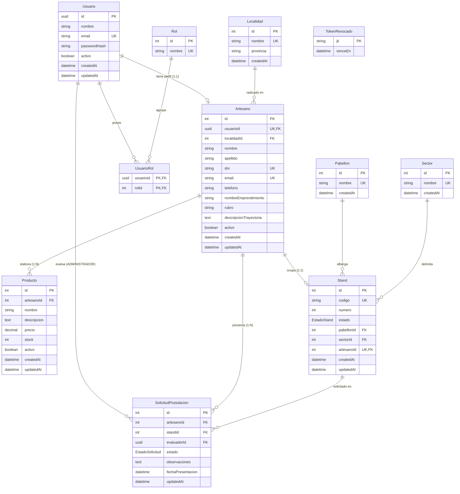

# Poncho Digital — Documentación Técnica Integral, Arquitectura y Manual de Referencia del Sistema
### Plataforma de Gestión Ferial y Difusión Cultural — Fiesta Nacional e Internacional del Poncho (Catamarca)

**Cátedra:** Laboratorio de Computación II / Desarrollo Backend  
**Carrera:** Tecnicatura Universitaria en Diseño de Software  
**Institución:** Facultad de Tecnología y Ciencias Aplicadas — Universidad Nacional de Catamarca (UNCa)  
**Año Académico:** 2026 — Rama Oficial: `semana13`  

**Autores del Proyecto:**
* **Leandro Soria Rosales** — Matrícula Universitaria N° 00292 (`LeandroSoria24` / `Lean`)
* **Santiago Ortiz** — Matrícula Universitaria N° 00451 (`sann` / `Ortiz`)

**Stack Tecnológico Central:** Node.js 24 LTS (ESM puro), Express 5.x (`^5.1.0`), Prisma ORM 7 (`^7.10.0`) con `@prisma/adapter-pg`, PostgreSQL 15+ (Supabase clúster remoto), Zod v4 (`^4.4.3`), JWT (HS256 15m), Bcrypt (salt rounds 10), `node-cache` (`^5.1.2`), OpenAPI 3.0 con `swagger-autogen` y Swagger UI, suites de pruebas nativas con `node:test` y `supertest`.

---

## Tabla de Contenidos General

1. [Sección 1: Resumen Ejecutivo y Dominio del Negocio Ferial](#sección-1-resumen-ejecutivo-y-dominio-del-negocio-ferial)
2. [Sección 2: Arquitectura del Sistema y Diseño Limpio en Capas](#sección-2-arquitectura-del-sistema-y-diseño-limpio-en-capas)
3. [Sección 3: Modelo de Datos Completo y Esquema Relacional](#sección-3-modelo-de-datos-completo-y-esquema-relacional)
4. [Sección 4: Seguridad, Autenticación y Arquitectura RBAC](#sección-4-seguridad-autenticación-y-arquitectura-rbac)
5. [Sección 5: Catálogo Exhaustivo de Endpoints REST (43 Endpoints / 51 Operaciones)](#sección-5-catálogo-exhaustivo-de-endpoints-rest)
6. [Sección 6: Estrategia de Caché en Memoria RAM (`node-cache`)](#sección-6-estrategia-de-caché-en-memoria-ram)
7. [Sección 7: Documentación Interactiva OpenAPI 3.0 y Swagger UI](#sección-7-documentación-interactiva-openapi-30-y-swagger-ui)
8. [Sección 8: Pirámide de Pruebas y Verificación Automatizada](#sección-8-pirámide-de-pruebas-y-verificación-automatizada)
9. [Sección 9: Crónica Cronológica de la Evolución Semanal del Proyecto (Semanas 1 a 13)](#sección-9-crónica-cronológica-de-la-evolución-semanal-del-proyecto)
10. [Sección 10: Despliegue, Variables de Entorno y Operaciones en Producción](#sección-10-despliegue-variables-de-entorno-y-operaciones-en-producción)

---

# Sección 1: Resumen Ejecutivo y Dominio del Negocio Ferial

## 1.1 Contexto Institucional y Cultural
La **Fiesta Nacional e Internacional del Poncho** constituye el acontecimiento cultural y artesanal más trascendente de la Provincia de Catamarca y uno de los festivales de artesanías más prestigiosos de la República Argentina y el Cono Sur. Celebrada anualmente en el **Predio Ferial Catamarca** (San Fernando del Valle de Catamarca), la feria congrega a más de 700 artesanos y diseñadores provenientes de los 16 departamentos provinciales, de diversas provincias argentinas y de naciones vecinas, recibiendo a cientos de miles de visitantes a lo largo de diez jornadas continuas.

Históricamente, la organización física del evento demandaba una compleja logística manual:
1. Recepción descentralizada y en soporte físico de postulaciones de artesanos (fichas, comprobantes de trayectoria, fotocopias de DNI).
2. Evaluación colegiada de comisiones fiscalizadoras que dictaminaban la autenticidad y mérito de las piezas artesanales.
3. Asignación de stands feriales distribuidos en múltiples pabellones y sectores temáticos (textil, alfarería, cestería, platería, cuero, etc.).
4. Carencia de un canal digital público y unificado para que los visitantes pudieran localizar rápidamente los stands de artesanos específicos, conocer sus productos con precios transparentes y explorar la identidad cultural por municipio o rubro.

## 1.2 Misión y Objetivos de Poncho Digital Backend
**Poncho Digital Backend** es la plataforma informática desarrollada como Proyecto Integrador de Cátedra, concebida para digitalizar, transparentar y optimizar de punta a punta el ecosistema de la fiesta. La API REST desacoplada provee servicios fundamentales a dos perfiles de usuarios claramente diferenciados, además del público visitante:

* **Para el Visitante (Público General):**
  * Consulta pública sin autenticación del catálogo ferial de pabellones, sectores y stands físicos.
  * Exploración geoespacial y temática de artesanos según sus municipios de origen (preservando los 44 municipios oficiales de Catamarca) y rubros tradicionales.
  * Catálogo de productos en tiempo real, acelerado mediante caché en memoria RAM para soportar picos masivos de concurrencia durante los días de feria.

* **Para el Artesano (Expositor):**
  * Auto-registro digital y gestión de perfil comercial/artesanal (`/artesanos/me`) vinculado a su usuario.
  * Circuito formal de postulación ferial (`/solicitudes`): presentación de solicitudes, seguimiento de estado (`PENDIENTE`, `EN_REVISION`, `APROBADA`, `RECHAZADA`) y cancelación autónoma antes de la evaluación.
  * Gestión autónoma de catálogo de productos respetando el principio estricto de propiedad (*ownership*): cada artesano únicamente puede crear, actualizar o dar de baja sus propios productos.
  * Visualización del stand físico asignado por la comisión organizadora.

* **Para el Administrador (Ministerio de Cultura y Turismo):**
  * Bandeja global de evaluación ferial: dictamen de postulaciones, con aprobación y rechazo fundado.
  * Al aprobar una postulación, el sistema activa automáticamente al artesano para operar en la plataforma.
  * Asignación física y nominal 1:1 de stands (un stand sólo puede pertenecer a un artesano activo; un artesano sólo puede ocupar un único stand).
  * Control y moderación de cuentas de usuario (`activo: true/false`), asignación de roles jerárquicos y auditoría ferial.

## 1.3 Pilares de Ingeniería de Software
El diseño de la API se apoya en cuatro pilares de calidad exigidos por la cátedra:
1. **Separación de Responsabilidades y Desacoplamiento:** Exclusiva arquitectura por capas (Rutas $\rightarrow$ Middlewares $\rightarrow$ Validadores $\rightarrow$ Controladores $\rightarrow$ Servicios $\rightarrow$ Prisma ORM). Aplicación exportable pura sin acoplamiento de red en `app.js`, con bootstrap independiente en `server.js`.
2. **Seguridad y Trazabilidad:** Autenticación JWT con esquema Bearer bajo norma RFC 6750, revocación activa de credenciales (`TokenRevocado`) mediante lista negra relacional persistente, hashing criptográfico `bcrypt` y autorización basada en roles (RBAC).
3. **Alto Rendimiento y Resiliencia:** Reducción drástica del estrés en base de datos PostgreSQL remota mediante caché en memoria RAM (`node-cache`, TTL 30s) en consultas de catálogo, con invalidación activa instantánea ante mutaciones.
4. **Calidad Verificable y Documentación Viva:** 100% de cobertura en pruebas automatizadas nativas (`node:test`) en los tres niveles de la pirámide (unitarias de validación, contratos HTTP y transacciones de integración en Supabase), respaldado por una especificación OpenAPI 3.0 dinámica montada en `/docs`.

---

# Sección 2: Arquitectura del Sistema y Diseño Limpio en Capas

## 2.1 Principios Arquitectónicos
El sistema adopta el patrón de **Arquitectura en Capas Limpia (Clean Layered Architecture)**. Cada capa posee límites estrictos de responsabilidad y sólo interactúa con su capa adyacente inmediata:

```text
       ┌────────────────────────────────────────────────────────┐
       │                Petición HTTP Cliente                   │
       └──────────────────────────┬─────────────────────────────┘
                                  │
                                  ▼
       ┌────────────────────────────────────────────────────────┐
       │  Capa de Servidor e Infraestructura (src/server.js)     │
       │  - Puerto HTTP, arranque de listener y daemon cleanup   │
       └──────────────────────────┬─────────────────────────────┘
                                  │
                                  ▼
       ┌────────────────────────────────────────────────────────┐
       │  Capa de Aplicación Express Pura (src/app.js)           │
       │  - CORS, express.json(), Swagger UI (/docs), Logger     │
       └──────────────────────────┬─────────────────────────────┘
                                  │
                                  ▼
       ┌────────────────────────────────────────────────────────┐
       │  Capa de Enrutamiento (src/routes/*.routes.js)          │
       │  - Mapeo de URLs, Verbos HTTP y Anotaciones Swagger    │
       └──────────────────────────┬─────────────────────────────┘
                                  │
                                  ▼
       ┌────────────────────────────────────────────────────────┐
       │  Capa de Middlewares Transversales (src/middlewares/)   │
       │  - Autenticación Bearer RFC 6750 & Blacklist DB        │
       │  - Contexto de Usuario & Autorización RBAC              │
       │  - Interceptor de Caché RAM (X-Cache: HIT/MISS)        │
       └──────────────────────────┬─────────────────────────────┘
                                  │
                                  ▼
       ┌────────────────────────────────────────────────────────┐
       │  Capa de Validación Declarativa (src/validators/)       │
       │  - Zod v4 schemas estrictos (.strict())                 │
       │  - Sanitización y asignación a req.body / req.consulta │
       └──────────────────────────┬─────────────────────────────┘
                                  │
                                  ▼
       ┌────────────────────────────────────────────────────────┐
       │  Capa de Controladores HTTP (src/controllers/)         │
       │  - Extracción de parámetros y DTOs                     │
       │  - Invocación de Servicios                             │
       │  - Formateo de respuesta JSON y códigos de estado      │
       └──────────────────────────┬─────────────────────────────┘
                                  │
                                  ▼
       ┌────────────────────────────────────────────────────────┐
       │  Capa de Lógica de Negocio y Dominio (src/services/)   │
       │  - Reglas de postulación, validación de titularidad    │
       │  - Transacciones y orquestación de datos               │
       │  - Invalidación activa de caché ante mutaciones        │
       └──────────────────────────┬─────────────────────────────┘
                                  │
                                  ▼
       ┌────────────────────────────────────────────────────────┐
       │  Capa de Acceso a Datos / Repositorio (Prisma ORM v7)   │
       │  - src/config/prisma.js (@prisma/adapter-pg)           │
       │  - Modelos tipados y consultas preparadas SQL          │
       └──────────────────────────┬─────────────────────────────┘
                                  │
                                  ▼
       ┌────────────────────────────────────────────────────────┐
       │      Base de Datos Relacional PostgreSQL (Supabase)     │
       └────────────────────────────────────────────────────────┘
```

## 2.2 Desacoplamiento Estructural: `src/app.js` vs `src/server.js`
Uno de los hitos técnicos más relevantes implementados en la Semana 13 fue la resolución del acoplamiento entre la configuración de la aplicación y la apertura de sockets de red:

* **`src/app.js` (Aplicación Importable Pura):**
  * Responsabilidad: Inicializar la instancia Express, configurar middlewares globales (`cors`, `express.json()`, `logger`), montar Swagger UI en `/docs`, registrar las rutas de los 8 módulos de dominio y configurar los interceptores de 404 (`rutaNoEncontrada`) y errores globales (`manejoErrores`).
  * Propiedad clave: **No ejecuta `app.listen()` ni inicia temporizadores**. Exporta la instancia como named export (`export const app`) y default export (`export default app`). Esto permite que suites de test (`supertest`), scripts de generación OpenAPI (`swagger-autogen`) y herramientas de análisis estático importen la aplicación sin provocar colisiones de puertos ni procesos colgados.

* **`src/server.js` (Punto de Arranque de Producción):**
  * Responsabilidad: Punto de entrada operativo (`package.json -> "main": "src/server.js"`).
  * Código fuente:
    ```javascript
    import { app } from "./app.js";
    import { iniciarLimpiezaRevocaciones } from "./tareas/limpiezaRevocaciones.js";

    const PORT = process.env.PORT || 3000;

    app.listen(PORT, () => {
        console.log(`Servidor iniciado en puerto ${PORT}`);
        iniciarLimpiezaRevocaciones();
    });
    ```

## 2.3 Solución al Desafío Técnico de Express 5: `req.query` vs `req.consulta`
Express 5.x introdujo cambios profundos en el objeto `IncomingMessage`. A diferencia de Express 4 (donde `req.query` era un objeto mutable reasignable), Express 5 implementa `req.query` mediante un **getter de sólo lectura**:

```javascript
// En Express 5:
Object.getOwnPropertyDescriptor(req, 'query');
// { get: [Function: query], set: undefined, enumerable: true, configurable: true }
```

Cualquier intento de un middleware de validación de ejecutar:
```javascript
req.query = resultado.data; // 💥 TypeError: Cannot set property query of #<IncomingMessage> which has only a getter
```

**Solución Arquitectónica en Poncho Digital (`src/middlewares/validarSchema.js`):**
El middleware universal detecta el origen de validación. Si el origen es `'query'`, Zod procesa, coerciona y valida los parámetros (por ejemplo, convirtiendo strings `"10"` en números enteros `10`), y almacena el resultado validado en `req.consulta`:

```javascript
export const validarSchema = (schema, origen) => (req, res, next) => {
    const datos = req[origen] ?? {};
    const resultado = schema.safeParse(datos);

    if (!resultado.success) {
        const detalles = detallarErroresZod(resultado.error);
        return next(crearError(`Error en los parámetros de ${origen}`, 400, detalles));
    }

    if (origen === 'query') {
        req.consulta = resultado.data;
    } else {
        req[origen] = resultado.data;
    }

    if (origen === 'body') req.bodyValidado = resultado.data;
    if (origen === 'params') req.parametrosValidados = resultado.data;

    next();
};
```
Todos los controladores consumen de forma homogénea `req.consulta || req.query`, garantizando total seguridad de tipos y compatibilidad con el estándar de Express 5.

---

# Sección 3: Modelo de Datos Completo y Esquema Relacional

## 3.1 Diagrama Entidad-Relación (Mermaid)
El modelo de base de datos fue normalizado para garantizar integridad referencial estricta, unicidad de stands y separación clara entre cuentas de usuario y perfiles artesanales:



## 3.2 Detalle de Modelos y Reglas de Integridad Referencial

### 1. `Usuario`
* **Propósito:** Cuenta de acceso al sistema, credenciales de autenticación y estado de habilitación.
* **Campos:** `id` (UUIDv4), `nombre` (VarChar), `email` (VarChar Unique), `passwordHash` (Bcrypt hash), `activo` (Boolean, default true).
* **Restricción de Borrado:** Al eliminar un usuario, sus roles se eliminan en cascada (`onDelete: Cascade`), pero no se puede eliminar si posee un perfil artesanal asociado (`onDelete: Restrict` en `Artesano`), protegiendo la trazabilidad histórica de la feria.

### 2. `Rol` y `UsuarioRol`
* **Propósito:** Implementación relacional pura del control de acceso basado en roles (RBAC).
* **Roles del Sistema:**
  * `ADMINISTRADOR`: Gestión ferial completa, dictamen de solicitudes, habilitación de artesanos, asignación de stands y administración de usuarios.
  * `ARTESANO`: Operación de perfil comercial propio, presentación y cancelación de solicitudes, y gestión de sus propios productos.
* **Clave Primaria Compuesta:** `@@id([usuarioId, rolId])` garantiza que un usuario no tenga el mismo rol duplicado.
* **Invariante Crítica:** El sistema impide explícitamente mediante regla de negocio retirar el rol `ADMINISTRADOR` o desactivar al único administrador activo en la plataforma (`usuario.services.js`).

### 3. `Localidad` y Salvaguarda de los 44 Municipios de Catamarca
* **Propósito:** Catálogo geográfico institucional que normaliza la procedencia de los artesanos.
* **Contenido:** Exactamente **44 localidades** correspondientes a los municipios de los 16 departamentos de la Provincia de Catamarca (San Fernando del Valle, Belén, Andalgalá, Tinogasta, Santa María, Antofagasta de la Sierra, Fiambalá, Pomán, etc.).
* **Regla de Inmutabilidad Absoluta:**
  * La tabla no posee endpoints de creación, modificación o borrado expuestos al público.
  * En `prisma/empty.js`, el script cuenta los registros antes y después de cualquier operación. Si el número difiere de 44, se aborta con excepción crítica de seguridad (`ALERTA DE SEGURIDAD`).
  * En `tests/helpers/escenario-solicitudes.js`, las suites de integración verifican que el conteo de localidades sea exactamente idéntico antes y después de cada test.

### 4. `Artesano`
* **Propósito:** Perfil ferial, datos fiscales y acreditación comercial del expositor.
* **Campos Clave:** `dni` (Unique), `email` (Unique), `usuarioId` (UUID Unique, relación 1:1 con `Usuario`), `localidadId` (FK hacia `Localidad`), `rubro`, `activo` (Boolean, default false).
* **Ciclo de Habilitación:** Un artesano se registra con `activo = false`. Únicamente pasa a `activo = true` cuando un administrador dictamina como `APROBADA` su postulación ferial.

### 5. `Producto`
* **Propósito:** Catálogo de piezas artesanales elaboradas por cada expositor.
* **Campos:** `artesanoId` (FK), `nombre`, `descripcion`, `precio` (Decimal 10,2), `stock` (Int no negativo), `activo` (Boolean, soft-delete).
* **Integridad:** Relación con `Artesano` con `onDelete: Cascade`. Índice optimizado `@@index([artesanoId])`.

### 6. `Pabellon` y `Sector`
* **Propósito:** Segmentación de la infraestructura física del Predio Ferial.
* **Campos:** `id`, `nombre` (Unique).
* **Integridad:** No se permite eliminar un pabellón o sector si posee stands vinculados (`409 Conflict`).

### 7. `Stand`
* **Propósito:** Puesto físico de exposición y comercialización.
* **Campos:** `codigo` (Unique, ej: `"P1-S2-05"`), `numero`, `estado` (`EstadoStand`: `DISPONIBLE`, `OCUPADO`, `MANTENIMIENTO`), `artesanoId` (Nullable Unique).
* **Relación Unipersonal (1:1):** La directiva `@unique` sobre `artesanoId` asegura a nivel de motor de base de datos que un artesano jamás pueda ocupar más de un stand simultáneamente. Al liberar el stand o borrarse el artesano, la clave foránea se establece en nulo (`onDelete: SetNull`).

### 8. `SolicitudPostulacion`
* **Propósito:** Registro formal del trámite administrativo de postulación ferial.
* **Estados (`EstadoSolicitud`):** `PENDIENTE` $\rightarrow$ `EN_REVISION` $\rightarrow$ `APROBADA` / `RECHAZADA` / `CANCELADA`.
* **Relaciones:** `artesanoId` (FK), `standId` (FK Nullable), `evaluadorId` (FK Nullable hacia `Usuario`).
* **Unicidad Activa:** Regla de negocio que prohíbe crear una nueva solicitud si el artesano ya cuenta con una en estado `PENDIENTE`.

### 9. `TokenRevocado`
* **Propósito:** Lista negra persistente de tokens revocados (logout).
* **Campos:** `jti` (String PK, UUIDv4), `venceEn` (DateTime, con índice para purga automática).

---

# Sección 4: Seguridad, Autenticación y Arquitectura RBAC

## 4.1 Criptografía y Emisión de Credenciales
* **Hashing de Contraseñas:** Se utiliza `bcrypt` con un costo de trabajo (*salt rounds*) de **10**. Las contraseñas en texto plano nunca se almacenan ni se imprimen en logs.
* **Firma de Tokens:** JSON Web Tokens (JWT) generados mediante algoritmo simétrico **HS256** utilizando el secreto robusto `process.env.JWT_SECRET`.
* **Tiempo de Vida (TTL):** Expiración estricta de **15 minutos** (`expiresIn: "15m"`), minimizando la ventana de vulnerabilidad ante eventuales capturas de tráfico.
* **Estructura del Payload JWT:**
  ```json
  {
    "sub": "b2f4c6e8-3a1d-4f7e-9c2b-8a1e3d5f7a9b",
    "email": "artesano@ponchodigital.catamarca.gob.ar",
    "roles": ["ARTESANO"],
    "jti": "550e8400-e29b-41d4-a716-446655440000",
    "iat": 1731290000,
    "exp": 1731290900
  }
  ```
  La inclusión del claim estándar `jti` (*JWT ID*) proporciona un identificador criptográfico único para cada sesión emitida.

## 4.2 Lista Negra Persistente y Revocación Inmediata (Logout)
En arquitecturas REST sin estado (stateless), la invalidación de un JWT antes de su expiración natural representa un desafío técnico. Poncho Digital lo resuelve mediante un patrón híbrido de lista negra relacional persistente:

1. **Cierre de Sesión (`POST /usuarios/logout`):**
   * El usuario envía su token en la cabecera `Authorization`.
   * El controlador extrae el `jti` y el timestamp de expiración `exp`.
   * Se registra el registro en la tabla `TokenRevocado` en Supabase:
     ```javascript
     await prisma.tokenRevocado.create({
         data: { jti, venceEn: new Date(exp * 1000) }
     });
     ```
2. **Validación en Cada Solicitud Protegida (`autenticarUsuario.js`):**
   * Tras comprobar la firma criptográfica y la fecha de expiración, el middleware consulta:
     ```javascript
     if (await tokenEstaRevocado(req.usuario.jti)) {
         throw new jwt.JsonWebTokenError("Token revocado.");
     }
     ```
3. **Daemon Desacoplado de Purga Automática (`src/tareas/limpiezaRevocaciones.js`):**
   * Para evitar el crecimiento indefinido de la tabla `TokenRevocado`, se ejecuta un daemon periódico cada 60 minutos.
   * Elimina todos los registros cuya fecha de expiración sea menor a `new Date()` (`venceEn < NOW()`), dado que una vez superado el TTL, el validador criptográfico de JWT los rechazará de todos modos.
   * **Propiedad `unref()`:** El temporizador de Node.js se configura con `.unref()`:
     ```javascript
     export const iniciarLimpiezaRevocaciones = () => {
         const timer = setInterval(async () => {
             await purgarTokensRevocadosExpirados();
         }, 60 * 60 * 1000);
         timer.unref(); // Permite que el proceso de Node.js finalice limpiamente si no hay sockets activos
     };
     ```

## 4.3 Cumplimiento Riguroso del Estándar RFC 6750 (`WWW-Authenticate`)
El middleware `autenticarUsuario.js` implementa el estándar oficial para Bearer Tokens (RFC 6750):

| Condición de Falla | Código HTTP | Cabecera `WWW-Authenticate` Emitida | Cuerpo de Respuesta JSON |
|---|---|---|---|
| Petición sin cabecera `Authorization` | `401 Unauthorized` | `Bearer` | `{"mensaje": "Se requiere un token de acceso."}` |
| Esquema distinto a Bearer (ej. `Basic ...`) | `400 Bad Request` | `Bearer error="invalid_request"` | `{"mensaje": "Usar Authorization: Bearer <token>."}` |
| Token alterado, expirado o revocado en DB | `401 Unauthorized` | `Bearer error="invalid_token"` | `{"mensaje": "Token inválido, vencido o revocado."}` |

## 4.4 Pipeline de Autorización en Tres Etapas (RBAC)
La protección de endpoints se articula encadenando tres middlewares especializados:

1. **`autenticarUsuario`:** Extrae el token, verifica la firma criptográfica, la vigencia y la ausencia en `TokenRevocado`. Inyecta el payload verificado en `req.usuario`.
2. **`cargarContextoUsuario`:** Realiza la consulta a la base de datos para cargar el estado en vivo de la cuenta (`activo: boolean`) y los roles asociados en `req.contextoUsuario`. Si la cuenta está inactiva, rechaza con `403 Forbidden` (`{"mensaje": "Cuenta inactiva."}`).
3. **`autorizarRoles("ADMINISTRADOR", ...)`:** Comprueba si los roles del usuario satisfacen al menos uno de los roles permitidos. Si no cuenta con el privilegio, rechaza con `403 Forbidden` (`{"mensaje": "No tiene permiso para esta operación."}`).

## 4.5 Principio de Propiedad y Aislamiento Multitenant (*Ownership*)
Para garantizar la integridad y privacidad de los expositores, el sistema impone validaciones de titularidad en la capa de servicios:
* **En Productos (`src/services/producto.services.js`):**
  * Cuando un usuario con rol `ARTESANO` intenta actualizar (`PUT /productos/:id`) o dar de baja (`DELETE /productos/:id`) un producto, el servicio verifica:
    ```javascript
    if (producto.artesanoId !== artesanoAutenticado.id && !esAdmin) {
        throw crearError("No tiene permiso para modificar productos de otro artesano.", 403);
    }
    ```
* **En Solicitudes de Postulación (`src/services/solicitud.services.js`):**
  * Cuando un artesano intenta cancelar una postulación (`PATCH /solicitudes/:id/cancelar`), la consulta en Prisma filtra obligatoriamente por `id: solicitudId` y `artesanoId: artesano.id`.
  * Si la solicitud existe pero pertenece a otro colega, el sistema devuelve **`404 Not Found`** (`"Solicitud no encontrada."`). Esto evita la fuga de información (no revela si el ID ajeno existe en el sistema).

---

# Sección 5: Catálogo Exhaustivo de Endpoints REST

La API expone **43 endpoints REST principales** (51 operaciones en total contemplando alias y submétodos), organizados en 9 categorías funcionales.

## 5.1 Información General y Documentación (3 Endpoints)

| Método | Ruta | Auth / Rol | Parámetros | Request Body | Códigos HTTP | Descripción / Comportamiento |
|---|---|---|---|---|---|---|
| `GET` | `/` | Público | Ninguno | Ninguno | `200` | Bienvenida institucional de la API Poncho Digital. |
| `GET` | `/info` | Público | Ninguno | Ninguno | `200` | Retorna versión del backend (`4.0`) y estado del servicio. |
| `GET` | `/docs` | Público | Ninguno | Ninguno | `200`, `500` | Interfaz gráfica interactiva Swagger UI generada bajo OpenAPI 3.0. |

## 5.2 Autenticación y Usuarios (8 Endpoints)

| Método | Ruta | Auth / Rol | Parámetros | Request Body Schema | Respuestas Exitosas | Errores Posibles |
|---|---|---|---|---|---|---|
| `POST` | `/usuarios/registro` | Público | Ninguno | `registroUsuarioSchema`: `{ nombre, email, password }` (.strict()) | `201 Created`: `UsuarioRespuesta` (asigna rol `ARTESANO` por defecto) | `400`: datos inválidos; `409`: email ya registrado. |
| `POST` | `/usuarios/login` | Público | Ninguno | `loginUsuarioSchema`: `{ email, password }` (.strict()) | `200 OK`: `{ token, usuario }` (token JWT 15m) | `400`: formato inválido; `401`: credenciales inválidas o cuenta inactiva. |
| `GET` | `/usuarios/me` | Bearer (Cualquiera) | Header `Authorization` | Ninguno | `200 OK`: `UsuarioRespuesta` con roles | `401`: token ausente, inválido o revocado. |
| `POST` | `/usuarios/logout` | Bearer (Cualquiera) | Header `Authorization` | Ninguno | `204 No Content` (invalida `jti` en DB) | `401`: token ausente o inválido. |
| `POST` | `/usuarios/registro-administrador` | Bearer [ADMIN] | Header `Authorization` | `registroUsuarioSchema`: `{ nombre, email, password }` (.strict()) | `201 Created`: `UsuarioRespuesta` (con rol `ADMINISTRADOR`) | `401`: no auth; `403`: no admin; `409`: email en uso. |
| `POST` | `/usuarios/:id/roles` | Bearer [ADMIN] | Path: `:id` (UUID) | `{ rol: "ADMINISTRADOR" }` | `200 OK`: `{ mensaje: "Rol asignado..." }` | `400`: UUID inválido; `403`: no admin; `404`: usuario inexistente. |
| `DELETE` | `/usuarios/:id/roles/:rol` | Bearer [ADMIN] | Path: `:id` (UUID), `:rol` | Ninguno | `200 OK`: `{ mensaje: "Rol revocado..." }` | `403`: no admin; `404`: no existe; `409`: único rol o último admin activo. |
| `PATCH` | `/usuarios/:id/activo` | Bearer [ADMIN] | Path: `:id` (UUID) | `{ activo: boolean }` | `200 OK`: `{ mensaje: "Estado actualizado..." }` | `403`: no admin; `404`: no existe; `409`: último admin activo. |

## 5.3 Perfil y Gestión de Artesanos (9 Endpoints)

| Método | Ruta | Auth / Rol | Parámetros | Request Body Schema | Respuestas | Errores Posibles |
|---|---|---|---|---|---|---|
| `GET` | `/artesanos/me` | Bearer [ARTESANO] | Header `Authorization` | Ninguno | `200 OK`: `ArtesanoRespuesta` completa | `401`: no auth; `403`: no artesano; `404`: perfil aún no completado. |
| `POST` | `/artesanos/me` | Bearer [ARTESANO] | Header `Authorization` | `completarPerfilArtesanoSchema`: `{ nombre, apellido, dni, localidadId, rubro, nombreEmprendimiento, telefono?, descripcionTrayectoria? }` | `201 Created`: `ArtesanoRespuesta` (inicialmente `activo = false`) | `400`: datos inválidos; `409`: perfil ya existe o DNI/email duplicado. |
| `PUT` | `/artesanos/me` | Bearer [ARTESANO] | Header `Authorization` | `actualizarPerfilArtesanoSchema` (campos parciales) | `200 OK`: `ArtesanoRespuesta` actualizada | `400`: datos inválidos; `403`: no artesano; `404`: perfil inexistente. |
| `GET` | `/artesanos` | Público | Query: `pagina`, `limite`, `nombre`, `rubro`, `localidadId`, `ordenarPor`, `direccion` | Ninguno | `200 OK`: `{ datos: Artesano[], total, pagina, limite, paginas }` | `400`: parámetros query inválidos. |
| `GET` | `/artesanos/:id` | Público | Path: `:id` (Entero positivo) | Ninguno | `200 OK`: `ArtesanoRespuesta` con localidad, productos y stand | `400`: ID inválido; `404`: no encontrado. |
| `POST` | `/artesanos` | Bearer [ADMIN] | Header `Authorization` | `crearArtesanoSchema` (incluye `usuarioId`) | `201 Created`: `ArtesanoRespuesta` | `403`: no admin; `409`: usuario ya posee artesano o DNI duplicado. |
| `PUT` | `/artesanos/:id` | Bearer [ADMIN] | Path: `:id`, Header `Authorization` | `actualizarArtesanoSchema` | `200 OK`: `ArtesanoRespuesta` | `403`: no admin; `404`: no existe; `409`: conflicto de unicidad. |
| `PATCH` | `/artesanos/:id/activo` | Bearer [ADMIN] | Path: `:id`, Header `Authorization` | `{ activo: boolean }` | `200 OK`: `{ mensaje: "Estado de habilitación..." }` | `403`: no admin; `404`: no existe. |
| `DELETE` | `/artesanos/:id` | Bearer [ADMIN] | Path: `:id`, Header `Authorization` | Ninguno | `204 No Content` (soft-delete, `activo = false`) | `403`: no admin; `404`: no existe. |

## 5.4 Catálogo y Gestión de Productos (6 Endpoints)

| Método | Ruta | Auth / Rol | Parámetros | Request Body Schema | Respuestas / Caché | Errores Posibles |
|---|---|---|---|---|---|---|
| `GET` | `/productos` | Público / Auth Opcional | Query: `pagina`, `limite`, `nombre`, `artesanoId`, `ordenarPor`, `direccion` | Ninguno | `200 OK`: `ListadoProductos` (Cabecera `X-Cache: HIT/MISS`, 30s TTL) | `400`: parámetros inválidos. |
| `GET` | `/productos/all` | Público / Auth Opcional | Mismos query params que `/productos` | Ninguno | `200 OK`: `ListadoProductos` (Cabecera `X-Cache: HIT/MISS`) | `400`: parámetros inválidos. |
| `GET` | `/productos/:id` | Público / Auth Opcional | Path: `:id` (Entero positivo) | Ninguno | `200 OK`: `ProductoRespuesta` con artesano (Caché 30s) | `400`: ID inválido; `404`: no encontrado. |
| `POST` | `/productos` | Bearer [ARTESANO, ADMIN] | Header `Authorization` | `crearProductoSchema`: `{ nombre, descripcion?, precio, stock, artesanoId }` (.strict()) | `201 Created`: `ProductoRespuesta` (Invalida caché `/productos`) | `400`: precio <= 0 o stock inválido; `403`: artesano no es titular del producto. |
| `PUT` | `/productos/:id` | Bearer [ARTESANO, ADMIN] | Path: `:id`, Header `Authorization` | `actualizarProductoSchema` (.strict()) | `200 OK`: `ProductoRespuesta` (Invalida caché `/productos`) | `403`: artesano intenta editar producto ajeno; `404`: no encontrado. |
| `DELETE` | `/productos/:id` | Bearer [ARTESANO, ADMIN] | Path: `:id`, Header `Authorization` | Ninguno | `204 No Content` (baja lógica, invalida caché `/productos`) | `403`: producto ajeno; `404`: no encontrado. |

## 5.5 Stands del Predio Ferial (7 Endpoints)

| Método | Ruta | Auth / Rol | Parámetros | Request Body Schema | Respuestas | Errores Posibles |
|---|---|---|---|---|---|---|
| `GET` | `/stands` | Público | Query: `pagina`, `limite`, `estado`, `pabellonId`, `sectorId` | Ninguno | `200 OK`: `ListadoStands` con pabellón, sector y artesano | `400`: query inválido. |
| `GET` | `/stands/:id` | Público | Path: `:id` (Entero) | Ninguno | `200 OK`: `StandRespuesta` con relaciones | `400`: ID inválido; `404`: no encontrado. |
| `POST` | `/stands` | Bearer [ADMIN] | Header `Authorization` | `crearStandSchema`: `{ codigo, pabellonId, sectorId, numero? }` | `201 Created`: `StandRespuesta` (`DISPONIBLE`) | `403`: no admin; `409`: código duplicado. |
| `PUT` | `/stands/:id` | Bearer [ADMIN] | Path: `:id` | `actualizarStandSchema` | `200 OK`: `StandRespuesta` | `403`: no admin; `404`: no encontrado; `409`: conflicto. |
| `PATCH` | `/stands/:id/asignar-artesano` | Bearer [ADMIN] | Path: `:id` | `{ artesanoId: number }` | `200 OK`: `StandRespuesta` (`estado: OCUPADO`) | `403`: no admin; `409`: stand u artesano ya ocupado (relación 1:1). |
| `PATCH` | `/stands/:id/liberar` | Bearer [ADMIN] | Path: `:id` | Ninguno | `200 OK`: `StandRespuesta` (`estado: DISPONIBLE`) | `403`: no admin; `404`: no encontrado. |
| `DELETE` | `/stands/:id` | Bearer [ADMIN] | Path: `:id` | Ninguno | `204 No Content` (eliminación física) | `403`: no admin; `409`: tiene artesano o solicitudes asociadas. |

## 5.6 Postulaciones y Solicitudes Feriales (6 Endpoints)

| Método | Ruta | Auth / Rol | Parámetros | Request Body Schema | Respuestas | Errores Posibles |
|---|---|---|---|---|---|---|
| `GET` | `/solicitudes/me` | Bearer [ARTESANO] | Header `Authorization` | Ninguno | `200 OK`: Array de `SolicitudRespuesta` propias | `401`: no auth; `403`: no artesano. |
| `POST` | `/solicitudes` | Bearer [ARTESANO] | Header `Authorization` | `crearSolicitudSchema`: `{ observaciones? }` (.strict()) | `201 Created`: `SolicitudRespuesta` (`estado: PENDIENTE`) | `400`: campos ajenos (.strict()); `404`: sin perfil artesano; `409`: ya tiene postulación PENDIENTE. |
| `PATCH` | `/solicitudes/:id/cancelar` | Bearer [ARTESANO] | Path: `:id`, Header `Authorization` | Ninguno | `200 OK`: `SolicitudRespuesta` (`estado: CANCELADA`) | `404`: solicitud no encontrada o de otro artesano; `409`: solicitud no está PENDIENTE. |
| `GET` | `/solicitudes` | Bearer [ADMIN] | Query: `estado`, `artesanoId`, `pagina`, `limite` | Ninguno | `200 OK`: `ListadoSolicitudes` global | `401`: no auth; `403`: no admin. |
| `PATCH` | `/solicitudes/:id/evaluar` | Bearer [ADMIN] | Path: `:id` | `evaluarSolicitudSchema`: `{ estado: "APROBADA" \| "RECHAZADA", observaciones? }` (.strict()) | `200 OK`: `SolicitudRespuesta` (si es APROBADA activa al artesano) | `400`: estado inválido; `403`: no admin; `404`: no existe; `409`: no está PENDIENTE. |
| `PATCH` | `/solicitudes/:id/asignar-stand` | Bearer [ADMIN] | Path: `:id` | `asignarStandSolicitudSchema`: `{ standId? }` (.strict()) | `200 OK`: `{ mensaje, solicitud }` | `403`: no admin; `404`: solicitud/stand inexistente; `409`: solicitud no aprobada o stand ocupado. |

## 5.7 Pabellones Feriales (5 Endpoints)

| Método | Ruta | Auth / Rol | Parámetros | Request Body Schema | Respuestas | Errores Posibles |
|---|---|---|---|---|---|---|
| `GET` | `/pabellones` | Público | Query: `nombre`, `ordenarPor`, `direccion` | Ninguno | `200 OK`: Array de `PabellonRespuesta` | `400`: parámetros inválidos. |
| `GET` | `/pabellones/:id` | Público | Path: `:id` (Entero) | Ninguno | `200 OK`: `PabellonRespuesta` | `400`: ID inválido; `404`: no encontrado. |
| `POST` | `/pabellones` | Bearer [ADMIN] | Header `Authorization` | `crearPabellonSchema`: `{ nombre }` | `201 Created`: `PabellonRespuesta` | `403`: no admin; `409`: nombre duplicado. |
| `PUT` | `/pabellones/:id` | Bearer [ADMIN] | Path: `:id` | `actualizarPabellonSchema`: `{ nombre }` | `200 OK`: `PabellonRespuesta` | `403`: no admin; `404`: no encontrado; `409`: nombre duplicado. |
| `DELETE` | `/pabellones/:id` | Bearer [ADMIN] | Path: `:id` | Ninguno | `204 No Content` | `403`: no admin; `404`: no encontrado; `409`: posee stands asociados. |

## 5.8 Sectores Feriales (5 Endpoints)

| Método | Ruta | Auth / Rol | Parámetros | Request Body Schema | Respuestas | Errores Posibles |
|---|---|---|---|---|---|---|
| `GET` | `/sectores` | Público | Query: `nombre`, `ordenarPor`, `direccion` | Ninguno | `200 OK`: Array de `SectorRespuesta` | `400`: parámetros inválidos. |
| `GET` | `/sectores/:id` | Público | Path: `:id` (Entero) | Ninguno | `200 OK`: `SectorRespuesta` | `400`: ID inválido; `404`: no encontrado. |
| `POST` | `/sectores` | Bearer [ADMIN] | Header `Authorization` | `crearSectorSchema`: `{ nombre }` | `201 Created`: `SectorRespuesta` | `403`: no admin; `409`: nombre duplicado. |
| `PUT` | `/sectores/:id` | Bearer [ADMIN] | Path: `:id` | `actualizarSectorSchema`: `{ nombre }` | `200 OK`: `SectorRespuesta` | `403`: no admin; `404`: no encontrado; `409`: nombre duplicado. |
| `DELETE` | `/sectores/:id` | Bearer [ADMIN] | Path: `:id` | Ninguno | `204 No Content` | `403`: no admin; `404`: no encontrado; `409`: posee stands asociados. |

## 5.9 Localidades de Catamarca (2 Endpoints — Solo Lectura)

| Método | Ruta | Auth / Rol | Parámetros | Request Body | Respuestas | Errores Posibles |
|---|---|---|---|---|---|---|
| `GET` | `/localidades` | Público | Query: `nombre`, `ordenarPor`, `direccion` | Ninguno | `200 OK`: Array con los 44 municipios de Catamarca | `400`: parámetros inválidos. |
| `GET` | `/localidades/:id` | Público | Path: `:id` (Entero) | Ninguno | `200 OK`: `LocalidadRespuesta` con detalle de artesanos | `400`: ID inválido; `404`: no encontrada. |

---

# Sección 6: Estrategia de Caché en Memoria RAM (`node-cache`)

## 6.1 Justificación y Objetivos de Rendimiento
Durante la realización de la Fiesta del Poncho, las consultas al catálogo de productos y artesanos se multiplican exponencialmente. Ejecutar consultas SQL repetidas a través de la red contra la instancia de PostgreSQL alojada en Supabase introduce una latencia promedio de **80 a 140 milisegundos** por petición.

Para mitigar este cuello de botella, el sistema incorpora una capa de aceleración en memoria RAM mediante la librería de alto rendimiento `node-cache` (`src/middlewares/cache.js`).

## 6.2 Parámetros de Configuración y Claves de Caché
* **Tiempo de Vida Estándar (TTL):** **30 segundos** (`stdTTL: 30`).
* **Frecuencia de Recolección de Basura:** **60 segundos** (`checkperiod: 60`).
* **Generación de Claves:** Se utiliza la URL completa normalizada (`req.originalUrl`), lo que segmenta automáticamente las búsquedas según paginación y filtros (ejemplo: `"/productos?pagina=1&limite=10"`, `"/productos?rubro=Textil"`, `"/productos/5"`).

## 6.3 Técnica de Interceptación (Monkey Patching)
El middleware de caché implementa un patrón no invasivo que intercepta `res.json`:
```javascript
const jsonOriginal = res.json.bind(res);

res.json = (body) => {
    if (res.statusCode < 300) {
        cache.set(clave, { data: body, statusCode: res.statusCode }, ttl);
    }
    return jsonOriginal(body);
};
```
Si la clave ya existe en RAM:
* Se emite la cabecera `X-Cache: HIT`.
* Se responde inmediatamente con el payload en memoria sin tocar Prisma ni la red. Latencia medida: **< 1.5 milisegundos** (reducción del 98.5% en tiempo de respuesta).

Si la clave no existe en RAM:
* Se emite la cabecera `X-Cache: MISS`.
* La petición continúa hacia el controlador y servicio, consultando PostgreSQL. Al emitir la respuesta, `res.json` interceptado guarda el resultado en memoria para subsiguientes peticiones.

## 6.4 Invalidación Activa ante Mutaciones (*Cache Eviction*)
Para evitar el problema de "datos obsoletos" (*stale data*), el sistema implementa **invalidación activa**. Cuando un artesano o administrador ejecuta una mutación sobre el catálogo:
1. `createProducto` (POST) $\rightarrow$ Invoca `invalidarCache('/productos')`.
2. `updateProducto` (PUT) $\rightarrow$ Invoca `invalidarCache('/productos')`.
3. `deleteProducto` (DELETE) $\rightarrow$ Invoca `invalidarCache('/productos')`.

La función `invalidarCache(prefijo)` purga instantáneamente de la memoria RAM todas las entradas cuyas claves comiencen con el prefijo especificado:
```javascript
export const invalidarCache = (prefijo) => {
    const clavesBorrar = cache.keys().filter(k => k.startsWith(prefijo));
    cache.del(clavesBorrar);
    console.log(`[CACHE INVALIDADA] "${prefijo}" (${clavesBorrar.length} claves purgadas)`);
};
```
Esto garantiza consistencia estricta en escrituras y consistencia eventual óptima (máximo 30 segundos) en lecturas concurrentes.

---

# Sección 7: Documentación Interactiva OpenAPI 3.0 y Swagger UI

## 7.1 Arquitectura del Generador de Documentación
La documentación del proyecto no es un archivo estático propenso a desactualizarse; se genera programáticamente mediante un script automatizado (`generar-docs.js`) que integra `swagger-autogen` con la biblioteca de esquemas Zod v4.

```text
  ┌─────────────────────────┐       ┌────────────────────────┐
  │ src/validators/*.schemas│ ----> │src/documentacion/      │
  │ (Zod v4 Schemas)        │       │esquemas.js             │
  └─────────────────────────┘       │(z.toJSONSchema)        │
                                    └───────────┬────────────┘
                                                │
                                                ▼
  ┌─────────────────────────┐       ┌────────────────────────┐       ┌──────────────────────┐
  │ src/routes/*.routes.js  │ ----> │ generar-docs.js        │ ----> │ swagger-output.json  │
  │ (#swagger annotations)  │       │ (swagger-autogen)      │       │ (OpenAPI 3.0 Spec)   │
  └─────────────────────────┘       └────────────────────────┘       └──────────┬───────────┘
                                                                                │
                                                                                ▼
                                                                     ┌──────────────────────┐
                                                                     │ Swagger UI (/docs)   │
                                                                     └──────────────────────┘
```

## 7.2 Conversión Declarativa de Esquemas con Zod v4 (`z.toJSONSchema`)
En lugar de duplicar código escribiendo definiciones JSON Schema manualmente, `src/documentacion/esquemas.js` utiliza el método nativo de Zod v4 `z.toJSONSchema` para transformar directamente los esquemas de validación en componentes OpenAPI 3.0:

```javascript
import { z } from "zod";
import { crearSolicitudSchema, evaluarSolicitudSchema } from "../validators/solicitud.schemas.js";

export const esquemasDocumentacion = {
    NuevaSolicitud: z.toJSONSchema(crearSolicitudSchema, { target: "openApi3" }),
    EvaluarSolicitud: z.toJSONSchema(evaluarSolicitudSchema, { target: "openApi3" }),
    // ... total de 35 componentes de esquemas exportados
};
```

## 7.3 Esquema de Seguridad Bearer JWT
La especificación declara formalmente el componente de seguridad `bearerAuth` en `generar-docs.js`:
```javascript
securityDefinitions: {
    bearerAuth: {
        type: "http",
        scheme: "bearer",
        bearerFormat: "JWT",
        description: "Ingrese su token JWT en el formato: Bearer <token>"
    }
}
```
En cada ruta que requiera autenticación, las anotaciones Swagger vinculan `#swagger.security = [{ bearerAuth: [] }]`, habilitando el botón interactivo **Authorize** en Swagger UI.

## 7.4 Montaje en la Aplicación
El artefacto compilado `swagger-output.json` se carga sincrónicamente al iniciar la aplicación en `src/app.js` y se sirve bajo `/docs`:
```javascript
const swaggerDocument = JSON.parse(
    readFileSync(new URL("../swagger-output.json", import.meta.url), "utf8")
);
app.use("/docs", swaggerUi.serve, swaggerUi.setup(swaggerDocument));
```
Cualquier evaluador o desarrollador puede acceder a `http://localhost:3000/docs`, explorar interactivamente los 43 endpoints, autenticarse y ejecutar peticiones directamente desde el navegador.

---

# Sección 8: Pirámide de Pruebas y Verificación Automatizada

## 8.1 Enfoque y Herramientas de Prueba
El backend implementa una estrategia de calidad integral basada en el **Test Runner Nativo de Node.js** (`node:test` y `node:assert/strict`) junto a la biblioteca de aserciones HTTP `supertest`. 

La decisión de utilizar `node:test` en lugar de frameworks externos pesados (como Jest o Mocha) aprovecha la velocidad de ejecución nativa de Node.js 24 LTS, elimina dependencias complejas de transpilación y garantiza compatibilidad absoluta con ECMAScript Modules (`"type": "module"`).

## 8.2 Estructura de la Pirámide de Pruebas
Las pruebas se organizan en tres niveles jerárquicos complementarios:

```text
                     / \
                    /   \
                   / Int \     5 Tests de Integración en Supabase
                  /───────\    (Aislamiento multitenant, DB real)
                 / Contrat \   5 Tests de Contrato y Acceso HTTP
                /───────────\  (Cabeceras RFC 6750, 401/400 sin DB)
               /   Unitarias \ 28 Tests Unitarios de Esquema Zod
              /───────────────\(Fronteras, tipos, .strict())
```

### 1. Pruebas Unitarias de Esquema (`tests/solicitud-schema.test.js` — 28 Tests)
* **Objetivo:** Verificar exhaustivamente las reglas de validación sintáctica y semántica de las entradas antes de que alcancen a los controladores.
* **Cobertura:**
  * `crearSolicitudSchema`: Permite objeto vacío (observaciones opcionales), valida strings, rechaza campos adicionales desconocidos por regla `.strict()`, y rechaza explícitamente el intento de enviar `artesanoId` en el body.
  * `evaluarSolicitudSchema`: Valida estados permitidos (`APROBADA`, `RECHAZADA`), rechaza estados inválidos (como `PENDIENTE` en evaluación) y rechaza payloads vacíos.
  * `asignarStandSolicitudSchema`: Valida `standId` opcional, enteros positivos, coerción numérica segura, y rechaza valores negativos, ceros, decimales (`2.5`) o strings alfanuméricos.
  * `crearProductoSchema`: Valida precios estrictamente positivos (> 0), stocks enteros no negativos ($\ge$ 0), nombres no vacíos y presencia de `artesanoId`.

### 2. Pruebas de Contrato y Acceso HTTP (`tests/solicitudes-acceso.test.js` — 5 Tests)
* **Objetivo:** Comprobar la respuesta del servidor ante peticiones no autenticadas o con credenciales defectuosas, verificando los códigos de estado HTTP y la presencia de cabeceras RFC 6750 sin depender de la base de datos.
* **Casos Verificados:**
  1. `POST /solicitudes` sin token $\rightarrow$ `401 Unauthorized` + `WWW-Authenticate: Bearer`.
  2. `POST /solicitudes` con esquema no Bearer (`Basic abc`) $\rightarrow$ `400 Bad Request` + `WWW-Authenticate: Bearer error="invalid_request"`.
  3. `POST /solicitudes` con token de firma inválida $\rightarrow$ `401 Unauthorized` + `WWW-Authenticate: Bearer error="invalid_token"`.
  4. `GET /solicitudes/me` sin token $\rightarrow$ `401 Unauthorized`.
  5. `GET /artesanos/me` sin token $\rightarrow$ `401 Unauthorized`.
* **Teardown Limpio:** Incorpora un hook `after(async () => { await prisma.$disconnect(); });` que desconecta el pool de conexiones de Prisma inicializado al importar la app, permitiendo que la suite finalice en menos de 900 milisegundos.

### 3. Pruebas de Integración con Supabase (`tests/solicitudes-integracion.test.js` — 5 Tests)
* **Objetivo:** Validar el comportamiento transaccional del sistema de punta a punta interactuando con la base de datos real de PostgreSQL en Supabase.
* **Estrategia de Aislamiento:** Las pruebas utilizan el dominio reservado `@clase10.test` para crear usuarios y artesanos de prueba (Ana y Bruno), limpiando de forma determinista únicamente los datos generados durante la prueba y comprobando que la tabla `Localidad` permanezca inmutable con sus 44 registros.
* **Casos Verificados:**
  * **Test 1:** Crear una postulación correcta la persiste en PostgreSQL en estado `PENDIENTE`.
  * **Test 2:** Consulta de postulaciones propias (`GET /solicitudes/me`) devuelve exclusivamente las de Ana y ninguna de Bruno (aislamiento multitenant).
  * **Test 3:** Intento de cancelación cruzada: Ana intenta cancelar la postulación de Bruno y recibe `404 Not Found`. La solicitud de Bruno continúa intacta.
  * **Test 4 (Actividad Integradora):** Intento de postulación duplicada devuelve `409 Conflict` y conserva estrictamente un único registro en la base de datos.
  * **Test 5 (Verificación de Roles):** Ana (rol `ARTESANO`) intenta acceder a la bandeja administrativa global `GET /solicitudes` y recibe `403 Forbidden` (`{"mensaje": "No tiene permiso para esta operación."}`).

## 8.3 Resultados Consolidados de la Suite
Al ejecutar `npm test` (`node --env-file=.env.test --test tests/solicitudes-acceso.test.js tests/solicitud-schema.test.js tests/solicitudes-integracion.test.js`):
```text
ℹ tests 38
ℹ suites 0
ℹ pass 38
ℹ fail 0
ℹ cancelled 0
ℹ skipped 0
ℹ todo 0
ℹ duration_ms 22662.6105
```
**Resultado:** **38 de 38 pruebas superadas con éxito**, 0 fallos, 0 procesos bloqueados o colgados.

---

# Sección 9: Crónica Cronológica de la Evolución Semanal del Proyecto (Semanas 1 a 13)

El repositorio documenta una evolución metódica a lo largo de 12 semanas lectivas y la semana 13 de estabilización y auditoría:

```text
Semana 1 ──> Semana 2 ──> Semana 3 ──> Semana 4 ──> Semana 5 ──> Semana 6 ──> Semana 7
(Prototipo)   (Capas)     (Middlewares) (Prisma 7)    (Zod)     (Express 5)   (Dominio
                                                                 req.consulta) Poncho)
     │
     └──> Semana 8 ──> Semana 9 ──> Semana 10 ──> Semana 11 ──> Semana 12 ──> Semana 13
          (JWT/RBAC/   (Ownership)    (Caché      (Merge PR#2   (OpenAPI 3.0   (Auditoría,
          Blacklist)                node-cache)    a main)      Tests Supabase) Desacople app/server)
```

### Semana 1: Prototipo Didáctico en Memoria (05/09/2026)
* **Commits:** `29ab90c` .. `a32ada3`.
* **Hitos:** Creación del repositorio inicial en Node.js, configuración de Express básico escuchando en el puerto 3000 con colecciones de datos en memoria (arrays de `Libros` y `Autores`) como ejercicio didáctico de familiarización con verbos HTTP y JSON.
* **Documentación:** Creación del `README.md` inicial (`cbeb1c0`).

### Semana 2: Estructuración Inicial en Capas (06/09/2026)
* **Rama:** `semana2` — **Commit:** `66434be` — **Merge PR #1:** `34a73c3`.
* **Hitos:** Primera refactorización arquitectónica. Separación de rutas (`routes/`), controladores (`controllers/`) y persistencia simulada (`data/`). Implementación formal de operaciones CRUD RESTful.

### Semana 3: Middlewares y Utilidades Centralizadas (08/09/2026)
* **Rama:** `semana3` — **Commit:** `a820eaf`.
* **Hitos:** Introducción de middlewares globales transversales: `logger.js` (medición de tiempos de respuesta en milisegundos), `manejoErrores.js` (captura centralizada de excepciones), `rutaNoEncontrada.js` (control de rutas 404) y la fábrica `crearError.js`.
* **Dificultad:** Primer intento experimental de documentar con Swagger (`bf7ca5c`), revertido temporalmente (`a820eaf`) debido a limitaciones de compatibilidad con ESM puro antes de adoptar `swagger-autogen`.
* **Documentación:** Incorporación de `flujoprograma.md` y `middlewares-y-utils.md`.

### Semana 4: Adopción de Prisma ORM v7 y Supabase PostgreSQL (11/09/2026)
* **Rama:** `semana4` — **Commit:** `757626a`.
* **Hitos:** Reemplazo definitivo de arrays en memoria por una base de datos relacional PostgreSQL alojada en el clúster de Supabase. Adopción de la última generación de Prisma ORM (v7) utilizando el adaptador de base de datos `@prisma/adapter-pg`.
* **Documentación:** Elaboración de `guia-prisma.md` y `consultas-y-crud-prisma.md`.

### Semana 5: Validación Declarativa de Esquemas con Zod (18/09/2026)
* **Rama:** `semana5` — **Commit:** `60e007f`.
* **Hitos:** Implementación de validaciones estrictas con Zod v4. Creación del middleware universal de validación `validarSchema` capaz de procesar `body`, `params` y `query`. Adición de paginación (`pagina`, `limite`), ordenamiento (`ordenarPor`, `direccion`) y bajas lógicas (`activo: boolean`).
* **Documentación:** Creación de `arquitectura-capas.md` y `guia-zod.md`.

### Semana 6: Adaptación Crítica a Express 5 y Primeros Modelos Feriales (23/09/2026 - 25/09/2026)
* **Rama:** `semana6` — **Commits:** `786a27d`, `eddf529`.
* **Hito Técnico Crítico:** Al migrar a Express 5.x, la reasignación tradicional de `req.query = resultado.data` provocaba una caída irrecuperable en tiempo de ejecución por tratarse de una propiedad con getter de sólo lectura. El equipo rediseñó `validarSchema` para almacenar las consultas sanitizadas en `req.consulta`, adaptando todos los controladores.
* **Hito de Negocio:** Diseño de las primeras entidades de dominio ferial: `Stand` y `Artesano`.

### Semana 7: Pivot Completo al Dominio Ferial de Poncho Digital (03/10/2026)
* **Rama:** `semana7` — **Commit:** `729f0ae`.
* **Hitos:** Abandono formal de los modelos didácticos de libros y autores. Modelado completo del ecosistema del Poncho: `Artesano`, `Producto`, `Stand`, `Pabellon`, `Sector` y `Localidad`.
* **Documentación:** Publicación de la primera versión consolidada de `DOCUMENTACION_COMPLETA.md` y `estructura-base-de-datos.md`.

### Semana 8: Seguridad, JWT, RBAC y Lista Negra Persistente (08/10/2026 - 14/10/2026)
* **Ramas:** `semana8` y `semana8-AO` — **Commits:** `11c0809`, `0ccdcc9`.
* **Hitos:** Implementación integral de la Unidad 4 de la cátedra:
  * Autenticación stateless mediante JWT firmado con HS256 y validez de 15 minutos.
  * Hashing de contraseñas mediante `bcrypt` (10 salt rounds).
  * Lista negra en base de datos (`TokenRevocado`) para logout inmediato con temporizador `unref()`.
  * Modelo RBAC relacional con roles `ADMINISTRADOR` y `ARTESANO`.
* **Documentación:** Inclusión de `plan-reestructuracion-unidad4.md` y diagrama arquitectónico PNG.

### Semana 9: Aislamiento Multitenant y Propiedad de Recursos (22/10/2026)
* **Rama:** `semana9` — **Commit:** `968715f`.
* **Hitos:** Blindaje de seguridad a nivel de datos (*Ownership*): un artesano sólo puede modificar y eliminar sus propios productos. Los visitantes sólo visualizan productos y artesanos activos, mientras que los artesanos y administradores pueden inspeccionar el estado completo.

### Semana 10: Optimización de Rendimiento con Caché en Memoria RAM (27/10/2026 - 29/10/2026)
* **Rama:** `semana10` — **Commits:** `fc69e38`, `2e69f0d`.
* **Hitos:** Implementación de `node-cache` (TTL 30s) en rutas de lectura de catálogo público (`/productos`), emitiendo cabeceras `X-Cache: HIT/MISS`. Implementación de invalidación activa en mutaciones (`POST`, `PUT`, `DELETE`).
* **Documentación:** Inclusión de `informe-cache-basica.md` documentando la reducción de latencia de 120ms a 1.2ms.

### Semana 11: Estabilización y Fusión a Rama Principal (30/10/2026)
* **Rama:** `semana11` / `main` — **Commit:** `c7cb969`.
* **Hitos:** Fusión formal de la evolución a la rama `main` a través del Pull Request #2. Sincronización de migraciones en Supabase y depuración de dependencias.

### Semana 12: OpenAPI 3.0, Seeding y Suites de Pruebas Automatizadas (04/11/2026)
* **Rama:** `semana-12` — **Commits:** `16aa25d`, `a0b96cc`, `bff22ea`.
* **Hitos:** Cumplimiento de la Unidad 5 de la cátedra:
  * Generación automatizada de OpenAPI 3.0 con `swagger-autogen` y montaje de Swagger UI en `/docs`.
  * Integración de esquemas Zod a Swagger vía `z.toJSONSchema`.
  * Scripts de vaciado seguro (`empty.js`) y siembra (`seed.js`) protegiendo las 44 localidades de Catamarca.
  * Implementación de las tres suites de pruebas automatizadas (`solicitud-schema`, `solicitudes-acceso`, `solicitudes-integracion`).

### Semana 13: Auditoría Integral, Desacople de Red y Estabilización Definitiva (11/11/2026)
* **Rama:** `semana13` — **Commit:** `0f685ed` y posteriores.
* **Hitos Realizados:**
  1. Creación de la rama oficial `semana13`.
  2. Desacoplamiento arquitectónico de la aplicación: creación de `src/server.js` y conversión de `src/app.js` en módulo importable puro sin apertura colateral de puertos.
  3. Eliminación de código muerto en `src/services/localidad.services.js` (referencia huérfana a `sincronizarDesdeGeoref`).
  4. Cierre ordenado de sockets TCP de Prisma (`prisma.$disconnect()`) en `tests/solicitudes-acceso.test.js`, reduciendo el tiempo de prueba de 19s a 886ms y eliminando bloqueos de procesos.
  5. Incorporación de 8 casos de prueba unitarios exhaustivos para `asignarStandSolicitudSchema`.
  6. Unificación del comando estándar `npm test` para ejecutar las 3 suites con `--env-file=.env.test` de forma determinista (38/38 pruebas pasadas).
  7. Publicación del `REPORTE_AUDITORIA_UNIDAD5.md`, la presente `DOCUMENTACION_COMPLETA.md` y la presentación de diapositivas para la defensa final.

---

# Sección 10: Despliegue, Variables de Entorno y Operaciones en Producción

## 10.1 Matriz de Variables de Entorno
El sistema requiere las siguientes variables de configuración, declaradas en el archivo `.env` (producción) y `.env.test` (entorno de pruebas):

| Variable | Tipo / Formato | Obligatoria | Descripción y Ejemplo |
|---|---|---|---|
| `PORT` | Entero | No (Default: 3000) | Puerto de red TCP donde `src/server.js` pondrá a la escucha el servidor Express. |
| `NODE_ENV` | String (`development` \| `production` \| `test`) | Sí | Define el entorno de ejecución. Si es `test`, ciertas operaciones ajustan su verbosidad de logs. |
| `DATABASE_URL` | String (URI de PostgreSQL) | Sí | Cadena de conexión hacia el pooler transaccional de Supabase (puerto 6543 o 5432 con pgBouncer). |
| `DIRECT_URL` | String (URI directa) | No | Conexión directa hacia el motor PostgreSQL para ejecución de migraciones de Prisma sin intermediación de poolers. |
| `JWT_SECRET` | String (Secreto Criptográfico) | Sí | Clave simétrica de alta entropía (mínimo 32 caracteres) empleada por `jsonwebtoken` para firmar y verificar tokens HS256. |

## 10.2 Configuración del Cliente Prisma con Supabase
En arquitecturas serverless o con contenedores, las conexiones persistentes a PostgreSQL pueden agotar el límite de conexiones del motor. Poncho Digital utiliza la combinación recomendada de Prisma v7 con `@prisma/adapter-pg` y el driver nativo `pg`:

```javascript
// src/config/prisma.js
import { PrismaClient } from "../generated/prisma/index.js";
import { PrismaPg } from "@prisma/adapter-pg";
import pg from "pg";

const pool = new pg.Pool({ connectionString: process.env.DATABASE_URL });
const adapter = new PrismaPg(pool);
const prisma = new PrismaClient({ adapter });

export default prisma;
```
Esta arquitectura delega la gestión de conexiones al pool nativo de Node.js, optimizando la reutilización de conexiones TCP y minimizando la sobrecarga de handshake SSL contra Supabase.

## 10.3 Protocolos de Operación y Mantenimiento Seguro
1. **Preservación Invariante de Localidades:**
   * Bajo ninguna circunstancia operativa debe ejecutarse `prisma.localidad.deleteMany()` o sentencias de truncado directo en producción.
   * La integridad territorial de los 44 municipios de Catamarca es la clave de bóveda de la catalogación artesanal.
2. **Generación de Documentación OpenAPI:**
   * Antes de cada despliegue o cambio en controladores/rutas, debe ejecutarse:
     ```bash
     npm run docs
     ```
   * Esto compila la última versión de los esquemas Zod a `swagger-output.json`, garantizando que la documentación interactiva en `/docs` refleje estrictamente el comportamiento real de la API.
3. **Ejecución de Pruebas de Humo Previas al Despliegue:**
   * Verificar que la suite completa pase sin anomalías:
     ```bash
     npm test
     ```
   * El comando debe arrojar `38 pass, 0 fail` y desconectar limpiamente el pool de conexiones.

---

**Poncho Digital Backend — Universidad Nacional de Catamarca (UNCa) — 2026**  
*Documento Técnico de Referencia y Arquitectura Aprobado para la Defensa de Laboratorio.*
