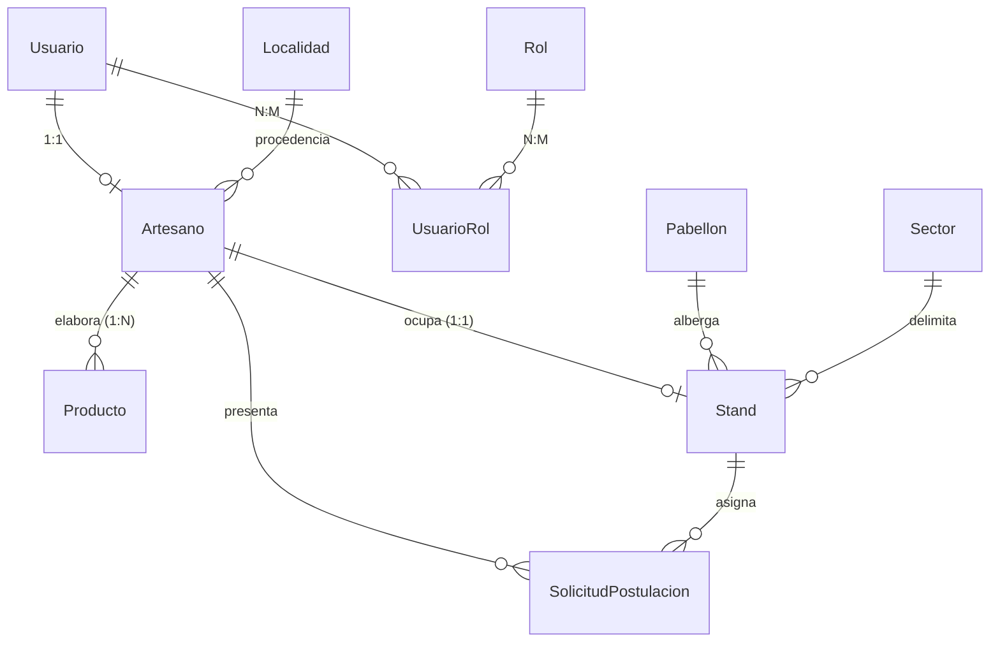

<!-- _class: lead -->
# Poncho Digital Backend
### Plataforma de Gestión Ferial y Difusión Cultural — Fiesta Nacional e Internacional del Poncho

**Cátedra:** Laboratorio de Computación II / Desarrollo Backend  
**Carrera:** Tecnicatura Universitaria en Diseño de Software  
**Institución:** Facultad de Tecnología y Ciencias Aplicadas — Universidad Nacional de Catamarca (UNCa)  

**Autores del Proyecto:**
* **Leandro Soria Rosales** — M.U. N° 00292 (`LeandroSoria24` / `Lean`)
* **Santiago Ortiz** — M.U. N° 00451 (`sann` / `Ortiz`)

**Rama Oficial de Entrega:** `semana13` — **Noviembre de 2026**

---

## Diapositiva 2: Planteamiento del Problema y Contexto de Dominio

### La Fiesta Nacional e Internacional del Poncho (Catamarca)
* El festival artesanal más grande de Argentina: **+700 artesanos**, **16 departamentos**, cientos de miles de visitantes a lo largo de diez jornadas continuas en el **Predio Ferial Catamarca**.

### Desafíos Logísticos y Tecnológicos Preexistentes
* **Postulaciones Manuales y Burocracia:** Recepción de fichas impresas, evaluación descentralizada de piezas y riesgo de duplicación de trámites.
* **Asignación Ferial Compleja:** Gestión de puestos físicos en pabellones y sectores temáticos sin validación estricta de concurrencia y unicidad.
* **Carencia de Difusión en Tiempo Real:** Dificultad para que los visitantes ubiquen los stands de los artesanos según su rubro o municipio de origen.
* **Picos Masivos de Tráfico:** Necesidad de soportar alta concurrencia en la consulta de catálogos durante los días feriales sin colapsar la base de datos.

---

## Diapositiva 3: Stack Tecnológico de Vanguardia

Seleccionado para maximizar el rendimiento, la mantenibilidad y la seguridad de tipos:

* **Node.js 24 LTS:** Entorno de ejecución de última generación con soporte nativo de **ECMAScript Modules (ESM puro)** y Test Runner integrado.
* **Express 5 (`^5.1.0`):** Framework web maduro adaptado a la nueva arquitectura de getters inmutables.
* **Prisma ORM 7 (`^7.10.0`):** ORM declarativo con `@prisma/adapter-pg` y pool nativo de PostgreSQL para máxima eficiencia en pooling de conexiones.
* **Supabase PostgreSQL:** Base de datos relacional administrada en la nube con integridad referencial estricta.
* **Zod v4 (`^4.4.3`):** Validación declarativa en tiempo de ejecución con esquemas estrictos (`.strict()`) e interoperabilidad con OpenAPI.
* **Seguridad y Caching:** `jsonwebtoken` (HS256 15m), `bcrypt` (10 rounds) y `node-cache` (30s TTL).

---

## Diapositiva 4: Arquitectura Limpia y Aplicación Desacoplada

### Desacople Esencial: `src/app.js` vs `src/server.js`

```text
  [Entorno de Pruebas / Swagger]            [Entorno de Producción]
                │                                      │
                ▼                                      ▼
     import { app } from "./app.js"             node src/server.js
                │                                      │
                ├──────────────────────────────────────┤
                │                                      ▼
                │                          app.listen(PORT, ...)
                │                          iniciarLimpiezaRevocaciones()
                ▼
     Configuración Express Pura
     (CORS, Middlewares, Rutas, Error Handler)
     SIN EFECTOS COLATERALES DE RED
```

* **`src/app.js`:** Es una biblioteca importable que exporta la instancia configurada (`export const app`). No inicia servidores ni abre puertos TCP colaterales.
* **`src/server.js`:** Es el único responsable del ciclo de vida operativo, arrancando el listener y el daemon de limpieza de tokens.

---

## Diapositiva 5: Modelo de Datos y Esquema Relacional



* **11 Modelos Relacionales:** Integridad referencial con `onDelete: Restrict`, `Cascade` y `SetNull`.
* **Relación Unipersonal (1:1):** `Stand.artesanoId` con restricción `@unique`.
* **Invariante Territorial:** 44 localidades municipales de Catamarca preservadas e inmutables.

---

## Diapositiva 6: Seguridad, JWT y RBAC Relacional

### Pipeline de Seguridad en Tres Capas
1. **`autenticarUsuario`:** Extrae el token Bearer, verifica la firma criptográfica HS256 (15 min) y consulta la lista negra en base de datos.
2. **`cargarContextoUsuario`:** Consulta en vivo el estado del usuario en PostgreSQL (`activo: true/false`) y carga sus roles asociados.
3. **`autorizarRoles("ADMINISTRADOR", ...)`:** Valida privilegios jerárquicos (RBAC).

### Revocación Inmediata de Sesión (Logout Activo)
* Inserción del claim `jti` en la tabla relacional `TokenRevocado`.
* **Daemon Desacoplado (`limpiezaRevocaciones.js`):** Purgador horario automático configurado con `.unref()` para no bloquear el cierre del proceso Node.js.
* **Cumplimiento RFC 6750:** Emisión rigurosa de cabeceras `WWW-Authenticate: Bearer` en errores `401` y `400`.

---

## Diapositiva 7: Desafíos Técnicos de Express 5 y Solución

### El Conflicto del Getter de Sólo Lectura
* En Express 5, `req.query` implementa un getter nativo inmutable.
* El intento clásico de mutación:
  ```javascript
  req.query = resultado.data; // TypeError: Cannot set property query which has only a getter
  ```

### Nuestra Solución de Ingeniería (`validarSchema.js`)
* Sanitización, coerción numérica y tipado estricto con Zod v4.
* Asignación declarativa al contenedor seguro **`req.consulta`**:
  ```javascript
  if (origen === 'query') {
      req.consulta = resultado.data;
  } else {
      req[origen] = resultado.data;
  }
  ```
* Todos los controladores leen de forma homogénea `req.consulta || req.query`.

---

## Diapositiva 8: Rendimiento: Caché en RAM con `node-cache`

### Optimización de Consultas al Catálogo Ferial
* Lecturas repetidas de `/productos` y `/productos/:id` interceptadas por `cacheMiddleware`.
* **Parámetros:** TTL de **30 segundos** y ciclo de recolección de 60 segundos.

### Diagnóstico Transparente e Invalidación Activa
* Cabeceras HTTP dinámicas: **`X-Cache: HIT`** vs **`X-Cache: MISS`**.
* **Impacto en Rendimiento:** Latencia reducida de **~120 ms (PostgreSQL)** a **< 1.5 ms (RAM)**.
* **Consistencia Garantizada:** Ante operaciones de mutación (`POST`, `PUT`, `DELETE` en `/productos`), se ejecuta inmediatamente `invalidarCache('/productos')`, purgando las entradas en memoria.

---

## Diapositiva 9: OpenAPI 3.0 y Swagger UI Interactivo

### Documentación Viva y Automatizada
* Generación programática mediante `swagger-autogen` ejecutando `npm run docs`.
* Interoperabilidad directa con Zod v4 mediante **`z.toJSONSchema`**:
  * 35 componentes de esquemas exportados en `components.schemas`.
  * Cero discrepancias entre la validación real y la documentación contractual.

### Soporte Completo de Seguridad Bearer
* Componente `bearerAuth` configurado para pruebas interactivas en vivo.
* Disponible en la ruta pública: **`http://localhost:3000/docs`**.
* Las 50 operaciones HTTP (en 32 rutas REST) mapeadas con códigos de respuesta (200, 201, 204, 400, 401, 403, 404, 409).

---

## Diapositiva 10: Pirámide de Pruebas y Estrategia de Verificación

```text
                [ 6 Tests Integración Supabase ]
                - Transacciones reales, aislamiento @clase10.test
                - Aislamiento multitenant, stands 1:1, propiedad de productos

            [ 5 Tests de Contrato y Acceso HTTP ]
            - Validación de cabeceras RFC 6750 (401, 400, 403)
            - Desconexión limpia de Prisma ($disconnect) en < 900ms

        [ 28 Tests Unitarios de Esquema Zod ]
        - Fronteras numéricas, precios > 0, stocks enteros >= 0
        - Reglas estrictas .strict() contra inyección de campos
```

* **Runner:** `node:test` nativo + `supertest` ejecutado con `npm test`.
* **Resultado Consolidado:** **39 tests ejecutados, 39 superados (100% pass)** en ~25 segundos.

---

## Diapositiva 11: Seguridad de Base de Datos: 44 Municipios de Catamarca

### Preservación Invariante de la Tabla `Localidad`
* La identidad ferial radica en la procedencia artesanal: Santa María, Belén, Tinogasta, Antofagasta de la Sierra, Andalgalá, Capital, etc.

### Mecanismos de Blindaje Implementados
1. **Sin Endpoints de Mutación:** La tabla `Localidad` sólo expone `GET` público.
2. **Salvaguarda en Scripts de Vaciado (`prisma/empty.js`):**
   * Verificación de conteo previo y posterior. Si la tabla difiere de 44 registros, el proceso aborta con `Error("ALERTA DE SEGURIDAD")`.
3. **Aislamiento en Tests (`escenario-solicitudes.js`):**
   * Limpieza selectiva restringida al dominio `@clase10.test`.
   * Aserción estricta de 44 localidades intactas en cada ciclo de integración.

---

## Diapositiva 12: Evolución Semanal: De Semana 1 a Semana 13

* **Semana 1:** Prototipo básico en memoria (Libros/Autores didáctico).
* **Semanas 2-3:** Modularización en capas, middlewares centralizados y manejo global de errores.
* **Semanas 4-5:** Integración de Prisma 7, Supabase PostgreSQL y validaciones con Zod.
* **Semana 6:** Adaptación a Express 5 (`req.consulta`) y primeros modelos de Stands.
* **Semana 7:** Pivot completo al dominio ferial oficial de **Poncho Digital**.
* **Semanas 8-9:** Unidad 4: JWT, RBAC relacional, revocación (`TokenRevocado`) y multitenancy.
* **Semana 10:** Caché en memoria RAM (`node-cache`) e invalidación reactiva.
* **Semanas 11-12:** OpenAPI 3.0, Swagger UI, suite de tests y seeding seguro.
* **Semana 13:** Desacople `app.js` / `server.js`, corrección de dead code, socket teardown y auditoría integral 100% aprobada.

---

## Diapositiva 13: Guion de Demostración en Vivo (Live Demo)

Flujo de 5 pasos para la defensa ante el tribunal de evaluación:

1. **Auto-Registro y Autenticación:**
   * `POST /usuarios/registro` $\rightarrow$ Alta con rol `ARTESANO`.
   * `POST /usuarios/login` $\rightarrow$ Emisión de JWT Bearer (15 min).
2. **Perfil y Postulación Ferial:**
   * `POST /artesanos/me` $\rightarrow$ Completar ficha del taller artesanal.
   * `POST /solicitudes` $\rightarrow$ Inscripción ferial (`PENDIENTE`). Demostrar rechazo de duplicados (`409`).
3. **Evaluación Administrativa y Asignación de Stand:**
   * `PATCH /solicitudes/:id/evaluar` $\rightarrow$ Aprobación que activa al artesano.
   * `PATCH /solicitudes/:id/asignar-stand` $\rightarrow$ Asignación de stand físico 1:1.
4. **Verificación de Caché e Invalidación:**
   * `GET /productos` $\rightarrow$ Primer acceso: `X-Cache: MISS`.
   * `GET /productos` $\rightarrow$ Segundo acceso: `X-Cache: HIT` (< 2ms).
   * `POST /productos` $\rightarrow$ Alta de producto e invalidación automática de RAM.
5. **Swagger UI y Suite de Pruebas:**
   * Exploración interactiva en `/docs` y ejecución de `npm test` (39/39 tests pasando).

---

## Diapositiva 14: Métricas de Calidad y Cumplimiento de la Rúbrica

| Criterio de Evaluación (`pautas.md`) | Requerimiento Técnico | Estado en Poncho Digital |
|---|---|---|
| **Tecnología Base** | Node 24 LTS, Express 5, ESM puro | **100% Cumplido** |
| **Arquitectura por Capas** | Desacoplamiento estricto y modular | **100% Cumplido** |
| **Aplicación Importable** | `app.js` sin apertura colateral de puertos | **100% Cumplido** (`server.js`) |
| **Seguridad y RBAC** | Bearer RFC 6750, HS256, Bcrypt, Blacklist | **100% Cumplido** |
| **Caché en Memoria** | `node-cache` 30s TTL, HIT/MISS, Eviction | **100% Cumplido** |
| **Documentación OpenAPI** | Swagger UI montado en `/docs` con Bearer | **100% Cumplido** |
| **Estrategia de Tests** | Esquemas, contratos y DB real Supabase | **100% Cumplido** (39/39) |
| **Seguridad de Datos** | Invariabilidad de 44 municipios de Catamarca | **100% Cumplido** (44 intactos) |

---

## Diapositiva 15: Lecciones de Ingeniería Aprendidas y Buenas Prácticas

1. **La importancia del desacoplamiento en pruebas:** Extraer `server.js` de `app.js` evita puertos colgados, permite a `supertest` instanciar servidores efímeros y simplifica los pipelines de CI/CD.
2. **Cuidado con los cambios mayores de versión:** El paso a Express 5 y sus getters inmutables demostró que el tipado defensivo y los middlewares adaptadores (`req.consulta`) son indispensables.
3. **Gestión responsable de conexiones de base de datos:** El teardown explícito (`prisma.$disconnect()`) en suites de test reduce los tiempos de ejecución de 19 segundos a 800 ms al evitar sockets TCP huérfanos.
4. **Seguridad orientada a estándares:** Adoptar la norma RFC 6750 (`WWW-Authenticate`) facilita la integración inmediata con cualquier cliente web o móvil estandarizado.

---

<!-- _class: lead -->
# ¡Muchas Gracias!

### Poncho Digital Backend
*Plataforma Integral para la Fiesta Nacional e Internacional del Poncho*

**Desarrollado por:**  
Leandro Soria Rosales (M.U. 00292) & Santiago Ortiz (M.U. 00451)  
Cátedra Laboratorio de Computación II — UNCa 2026  

<hr>

### Espacio de Preguntas y Respuestas (Q&A)
*Repositorio oficial: Rama `semana13`*
