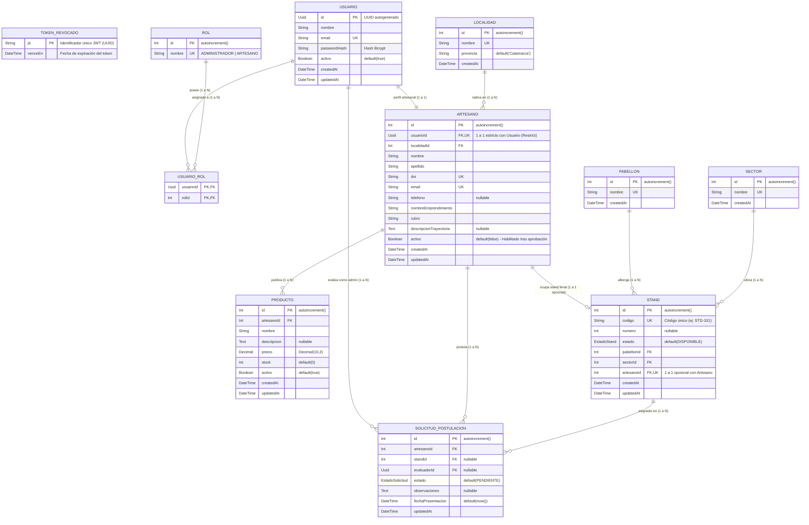

# Estructura del Esquema de Base de Datos — Poncho Digital

**Cátedra:** Desarrollo Backend  
**Proyecto:** Poncho Digital — API REST de la Fiesta Nacional e Internacional del Poncho  
**ORM:** Prisma 7 con PostgreSQL  

---

## 1. Introducción y Fundamentos Teóricos

El modelo de datos de **Poncho Digital** fue diseñado bajo los principios de **diseño relacional en Tercera Forma Normal (3FN)** para garantizar la integridad referencial, evitar redundancias innecesarias y representar con precisión las reglas del dominio de la feria artesanal y la seguridad de la Unidad 4 (Autorización y RBAC).

### Principales decisiones de diseño:
1. **Control de Acceso Basado en Roles (RBAC Relacional M:N):**  
   Se reemplazó el enum estático por una estructura normalizada `Rol` y `UsuarioRol`. Esto permite que un usuario pueda poseer múltiples roles (`ADMINISTRADOR`, `ARTESANO`), desacopla los permisos del registro de usuario y cumple con los estándares de seguridad de la cátedra.
2. **Cuentas Activas y Moderación:**  
   - `Usuario.activo` (`Boolean @default(true)`): permite inhabilitar el acceso al sistema de una cuenta comprometida o dada de baja.
   - `Artesano.activo` (`Boolean @default(false)`): los nuevos artesanos inician inactivos hasta que su postulación a la feria (`SolicitudPostulacion`) sea aprobada formalmente por un administrador.
3. **Identificadores Criptográficos (UUID) para Cuentas de Usuario:**  
   Se utiliza el tipo nativo `UUID` de PostgreSQL para la entidad `Usuario`. Esto previene ataques de enumeración (adivinación secuencial de IDs), desacopla la generación de identificadores y se alinea con estándares de seguridad modernos.
4. **Identificadores Enteros Autoincrementales para Entidades de Negocio:**  
   Las entidades del dominio físico o de catálogo (`Artesano`, `Producto`, `Stand`, `Pabellon`, `Sector`, `Localidad`, `SolicitudPostulacion`) emplean enteros autoincrementales (`SERIAL / Int`), optimizando el tamaño de los índices B-Tree en llaves foráneas y búsquedas por clave primaria.
5. **Manejo de Moneda con `Decimal(10, 2)`:**  
   En `Producto`, el precio se define como `Decimal(10, 2)` en lugar de coma flotante (`Float`), garantizando exactitud matemática sin pérdidas por redondeo binario.
6. **Soft Delete (Baja Lógica):**  
   `Artesano` y `Producto` implementan baja lógica vía `activo: false`, preservando el histórico de asignaciones feriales y ventas sin destruir registros.
7. **Lista Negra Persistente de Tokens Revocados (`TokenRevocado`):**  
   Para implementar un cierre de sesión seguro en un esquema de autenticación sin estado (stateless JWT), se modela una entidad dedicada con clave primaria `jti` (JWT ID criptográfico) y marca de tiempo `venceEn`. Un índice B-Tree sobre `venceEn` garantiza consultas ultrarrápidas y permite a tareas en segundo plano purgar masivamente registros expirados.

---

## 2. Diagrama Entidad-Relación (Mermaid)

---

## 3. Tipos Enumerados (Enums)

### `EstadoStand`
Controla la disponibilidad física y operativa de los espacios:
- **`DISPONIBLE`**: El stand no tiene ningún artesano asignado y está listo para ser otorgado.
- **`OCUPADO`**: Stand asignado a un artesano titular.
- **`MANTENIMIENTO`**: Stand inhabilitado temporalmente por refacciones técnicas, cableado o inspección.

### `EstadoSolicitud`
Gestiona el ciclo de vida del trámite de postulación ferial:
- **`PENDIENTE`**: Solicitud enviada por el artesano en espera de revisión administrativa.
- **`EN_REVISION`**: La solicitud está siendo analizada por el equipo evaluador.
- **`APROBADA`**: Postulación aceptada formalmente (activa al artesano y habilita la asignación del stand).
- **`RECHAZADA`**: Postulación desestimada con observaciones explicativas.
- **`CANCELADA`**: Postulación cancelada voluntariamente por el propio artesano solicitante antes de ser evaluada.

---

## 4. Modelos en Detalle

### 4.1. `Usuario`, `Rol` y `UsuarioRol` (RBAC)
- **`Usuario`**: Representa las credenciales de acceso (`email`, `passwordHash` con Bcrypt) y la bandera `activo`.
- **`Rol`**: Entidad de catálogo con valores únicos (`ADMINISTRADOR`, `ARTESANO`).
- **`UsuarioRol`**: Tabla intermedia que vincula usuarios con roles (`usuarioId_rolId`). Permite que un usuario administrador también pueda poseer el rol de artesano si participa en la feria.

### 4.2. `Artesano`
Entidad central del negocio. Representa al productor artesanal y su taller:
- **`usuarioId` (`UUID`, `@unique`)**: Relación 1:1 con `Usuario` bajo política `onDelete: Restrict` para impedir eliminar accidentalmente una cuenta de usuario que mantenga un perfil de artesano activo.
- **`activo` (`Boolean`, `@default(false)`)**: Se inicializa en `false` al completar el perfil y pasa a `true` automáticamente cuando la administración dictamina `APROBADA` su postulación.

### 4.3. `Stand` y Asignación 1:1
- **`artesanoId` (`Int? @unique`)**: Relación 1:1 opcional con `Artesano`. Al ser `@unique`, el motor PostgreSQL impide a nivel relacional que un artesano posea más de un stand simultáneamente.
- **`onDelete: SetNull`**: Si el artesano se desvincula o da de baja, el espacio físico permanece intacto en el predio ferial en estado `DISPONIBLE`.

### 4.4. `SolicitudPostulacion`
- Registra el pedido formal del artesano para obtener espacio en la fiesta.
- Vincula al `artesanoId` (solicitante), `evaluadorId` (`Usuario` administrador que dictamina) y `standId` (stand asignado).

---

## 5. Resumen de Políticas de Integridad Referencial (`onDelete`)

| Origen | Destino | Relación | Política `onDelete` | Justificación de Negocio |
|---|---|---|---|---|
| `UsuarioRol` | `Usuario` | N a 1 | **`Cascade`** | Si se borra la cuenta, se eliminan sus asignaciones de roles. |
| `UsuarioRol` | `Rol` | N a 1 | **`Restrict`** | No se puede eliminar un rol del sistema si está asignado a usuarios. |
| `Artesano` | `Usuario` | 1 a 1 | **`Restrict`** | Evita la eliminación accidental de un usuario con perfil ferial registrado. |
| `Producto` | `Artesano` | N a 1 | **`Cascade`** | El catálogo depende íntegramente de la existencia de su artesano titular. |
| `Stand` | `Artesano` | 1 a 1 | **`SetNull`** | Si un artesano se da de baja, el stand físico se conserva y se libera. |
| `Stand` | `Pabellon` | N a 1 | **`Restrict`** | No se puede eliminar un pabellón que albergue stands. |
| `Stand` | `Sector` | N a 1 | **`Restrict`** | No se puede eliminar un sector mientras contenga stands. |
| `Solicitud` | `Artesano` | N a 1 | **`Cascade`** | Las postulaciones son propiedad exclusiva del artesano solicitante. |
| `Solicitud` | `Usuario` | N a 1 | **`SetNull`** | Si un evaluador se elimina, la postulación preserva su histórico de auditoría. |
| `TokenRevocado` | *Independiente* | Sin FK | **—** | Tabla de revocación técnica administrada por purga automática temporal (`deleteMany`). |
